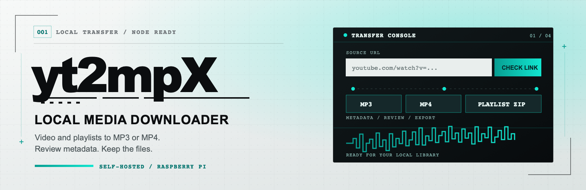

# yt2mpX

A local web app for Raspberry Pi: paste a YouTube video or playlist URL, choose MP3 or MP4, review the metadata, and download the finished file in your browser.

> Only use this app for content you are allowed to download.

## Getting started

```bash
docker compose up --build
```

Open the app on your home network:

```text
http://<pi-ip>:8765
```

On the development machine, open `http://localhost:8765`.

The Docker image includes Deno and yt-dlp's JavaScript challenge solver. If you run the Python app directly on macOS instead of with Docker, install the Python requirements and a supported JavaScript runtime such as Deno (`brew install deno`). Without both components, yt-dlp may report `Requested format is not available` even for a public video. See the [yt-dlp EJS setup guide](https://github.com/yt-dlp/yt-dlp/wiki/EJS). Account-enabled jobs use YouTube's `web_safari` client, whose HLS streams can avoid HTTP 403 responses caused by missing GVS PO Tokens. Availability of those streams varies by account and video; see the [yt-dlp PO Token guide](https://github.com/yt-dlp/yt-dlp/wiki/PO-Token-Guide).

## How it works

1. Check a video or playlist URL. Choose the format, quality, and playlist items.
2. As each file finishes downloading and converting, it appears in a compact track list with a small cover, YouTube title, artist and album, and a live status badge. Fingerprinting and metadata lookup start while later files are still downloading.
3. A confident AcoustID/MusicBrainz match becomes the active metadata automatically and is written into that finished file, including its cover. A definite no-match uses and writes the YouTube fallback. Temporary errors such as HTTP 503 remain untagged and are retried after the first pass.
4. When every file and lookup is finished, use the pencil on a track to edit only that track. Its tags are rewritten if the metadata changes. Choose **Prepare download** to package the already tagged files. The original YouTube title, artist and album stay visible below the active data for comparison.

Playlist items can be selected with checkboxes or ranges such as `1-20`, `1-20,45,60`, and `4,8,12`. Playlists are delivered as ZIP files. The app shows the download size and, for ZIP files, the approximate extracted size. Temporary downloads are listed in the browser's history panel while they remain available on the server.

For cover art, the app tries MusicBrainz/Cover Art Archive first and falls back to the YouTube thumbnail if needed. MP3 cover art is optional. MP4 downloads prefer H.264/AAC for compatibility with QuickTime, iOS, and macOS, but may use another format when needed. Single videos are named `Title - Artist`; playlist files omit the YouTube ID and duplicate titles receive a numeric suffix.

Multiple browsers or devices can start jobs at the same time. Finished jobs are removed after `YTMPX_JOB_TTL_MINUTES` from their last update; cleanup runs every five minutes.

## Configuration

The main settings are in `docker-compose.yml`. You can add other environment variables if needed:

- `YTMPX_JOB_TTL_MINUTES`: How long completed downloads remain on the Pi (30 minutes in Docker Compose).
- `YTMPX_MAX_PLAYLIST_ITEMS`: Maximum number of playlist items per job (100 in Docker Compose).
- `YTMPX_PROBE_TIMEOUT_SECONDS`: Link check timeout (default: 75 seconds; not set in Docker Compose).
- `YTMPX_YTDLP_SOCKET_TIMEOUT_SECONDS`: yt-dlp network timeout (default: 30 seconds; not set in Docker Compose).
- `YTMPX_YOUTUBE_COOKIES_FILE`: Path to an optional Netscape-format YouTube cookie file inside the container (`/run/yt2mpx-secrets/youtube-cookies.txt` in Docker Compose).
- `YTMPX_ACOUSTID_API_KEY`: AcoustID Application API Key for audio fingerprint matching. The app still works without it, using fallback metadata.
- `YTMPX_MUSICBRAINZ_USER_AGENT`: MusicBrainz user agent, ideally with contact information.
- `./downloads:/data`: Local storage for temporary job files. Completed jobs are stored under `./downloads/jobs/<job_id>/`.

To configure these integrations, copy the template to `.env` and edit its values:

```bash
cp -n .env.example .env
```

Docker Compose reads `.env` automatically. To enable fingerprint matching, sign in to AcoustID and [register an application](https://acoustid.org/new-application). Put its **Application API Key** in `YTMPX_ACOUSTID_API_KEY` (not your AcoustID user key). Leave this field empty to use fallback metadata.

MusicBrainz does not require an API key for metadata lookups. Set `YTMPX_MUSICBRAINZ_USER_AGENT` to an application name and version with a contact URL or email address, following the [MusicBrainz User-Agent guidelines](https://musicbrainz.org/doc/MusicBrainz_API/Rate_Limiting#Provide_meaningful_User-Agent_strings).

Metadata lookup visits every finished track once, then retries only temporary service errors in later passes. MusicBrainz requests are spaced at least 1.1 seconds apart across all jobs. The app honors `Retry-After` and pauses after repeated HTTP 503 responses. The ten-minute limit for unresolved lookups starts after the last file finishes downloading; remaining tracks then receive YouTube fallback tags. File tagging runs one track at a time across jobs, while downloads and lookups continue. The final ZIP is built only after all files and tag writes are complete.

Keep `.env` private; only `.env.example`, which contains no credentials, belongs in Git.

## Private and age-restricted YouTube content

If your YouTube account has access to the content, you can opt in to using its cookies for a link. Create `secrets/` next to `docker-compose.yml` and place a Netscape-format export of **youtube.com cookies only** at `secrets/youtube-cookies.txt`. Restrict access to the file (for example, `chmod 600 secrets/youtube-cookies.txt` on the Pi). The `secrets/` directory is ignored by Git and mounted read-only in the container. Keep the file private; it grants access to your account session. Start or restart Docker Compose, then select **Use YouTube account for this link** before checking the link. The same setting is used for the download. Without a cookie file, the switch is hidden and public downloads continue to work anonymously.

Follow the [yt-dlp YouTube cookie export instructions](https://github.com/yt-dlp/yt-dlp-wiki/blob/master/Extractors.md#exporting-youtube-cookies): sign in in a fresh private/incognito window, navigate to `https://www.youtube.com/robots.txt` in that tab, export only the YouTube cookies in Netscape `cookies.txt` format, then close the private window. Do not use yt-dlp's combined `--cookies-from-browser` and `--cookies` command for this private session. The file must start with `# Netscape HTTP Cookie File` or `# HTTP Cookie File`. Use Unix (LF) line endings on the Pi.

To renew an expired session, replace `secrets/youtube-cookies.txt` with a fresh export. New link checks and jobs read the current file; no container rebuild is needed. If the switch is missing, check that the file exists and is readable inside the container. If yt-dlp reports an authentication error, export fresh cookies and confirm the account can open that content in YouTube. Cookies do not solve every YouTube restriction; [some formats or features may require a PO Token](https://github.com/yt-dlp/yt-dlp-wiki/blob/master/Extractors.md#youtube).

The app has no login: anyone who can use it on your home network can select the account switch. Use a dedicated account if appropriate, and limit access to the Pi. yt-dlp also warns that using an account can cause temporary or permanent account restrictions if requests are excessive.

## Quality options

- MP3 **High**: high VBR quality (`VBR 0`).
- MP3 **Medium**: approximately 192 kbps; the default.
- MP3 **Low**: approximately 128 kbps.
- MP3 **Minimal**: uses the smallest audio source and targets 32 kbps.
- MP4 **Best compatibility**: prefers the best available H.264/AAC variant.
- MP4 **1080p**, **720p**, or **360p**: prefers H.264/AAC and tries to limit video height. As a last fallback, another resolution may be selected.

MP3 quality and the cover-art option are saved in a browser session cookie. The temporary-download history uses an ID stored in the browser's local storage.

## Notes

- Private or age-restricted content requires an account that can access it and a working YouTube cookie file.
- Version 1 has no login. Run it only on a trusted home network.
- Future idea (not implemented): give each yt2mpX user a separate account and a supported way to authorize their own YouTube access without managing a shared cookie file. This depends on a reliable YouTube authentication method for yt-dlp; the current implementation still uses cookies.
